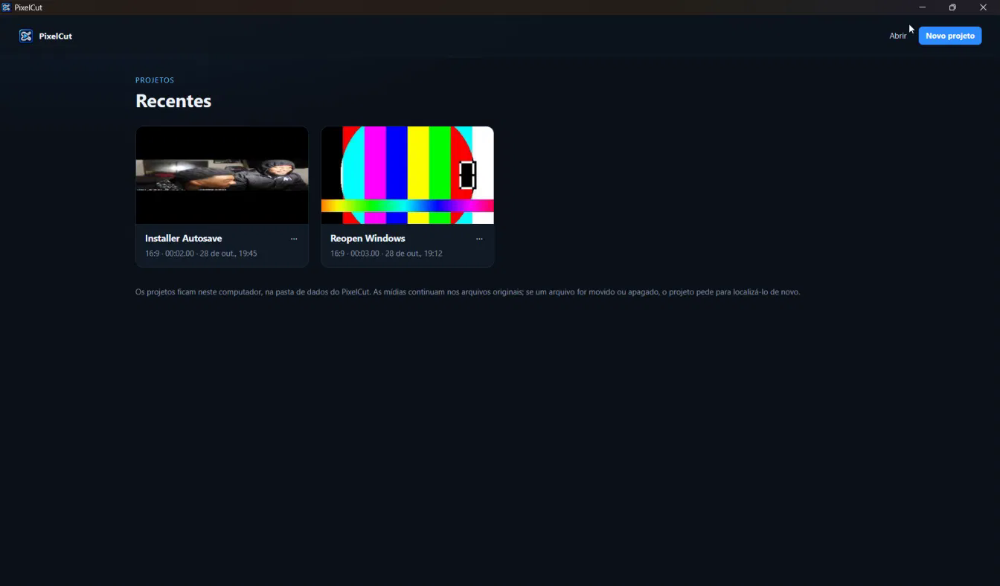
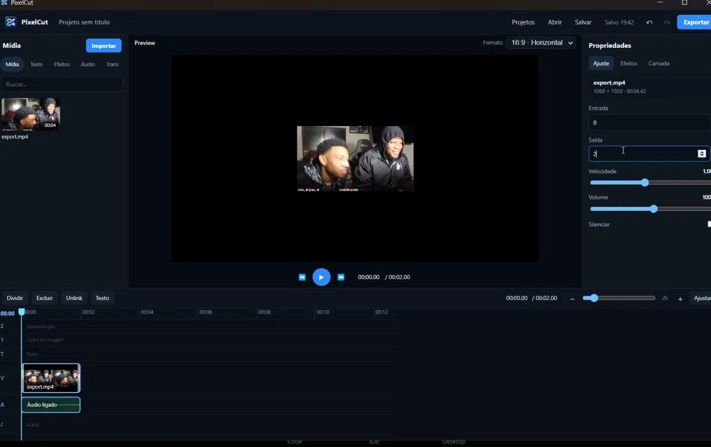

# PixelCut

PixelCut is a dark, multi-track video editor for **Windows 10/11 (x64)**, with an **Android** companion that is not at feature parity yet. It is a **free public beta**: expect sharp edges, and please file issues when something breaks.

This is not CapCut and is not affiliated with ByteDance.

<p>
  
</p>

**Downloads:** GitHub Releases for the planned public repository named **PixelCut**. The GitHub account/owner is not recorded in this tree, so no download URL is invented here. The first planned tag is `v0.1.0-beta.1`. Nothing has been uploaded yet.

## Screenshots

Home screen (recent projects on this computer):



Editor: media library, preview, inspector, and timeline (overlay, text, video, and audio tracks):



These are crops of the real PixelCut 0.1.0 window (28 October 2026), not mockups.

## Windows features

- **Recents**: create, open, rename, duplicate, and delete projects (delete asks for confirmation).
- **Autosave** into `%AppData%\PixelCut\projects` (about 700 ms after edits). Closing without Save still keeps the work.
- Import video, image, and audio; place clips on the timeline; trim, split, speed, and volume.
- Multi-track timeline: main video, overlay, text, audio, plus effects and transitions.
- **Preview and Windows export include visual effects, transitions, chroma key, overlays, titles, voice effects, and the music track.** Export is H.264 + AAC MP4 via FFmpeg. Duration follows the full timeline (`projectDuration`): after the main video ends, the background stays black, matching the preview.
- Undo / redo, keyboard shortcuts for play, split, and frame step.
- Projects are JSON plus local media paths. If a file moves, PixelCut asks you to relocate it. Deleting a project does not delete your original media.

## Android features

- Same editor UI (Capacitor) for browsing projects, editing the timeline, and previewing on the device player.
- Export uses AndroidX **Media3 Transformer**.

### Android export limitation

Android currently exports **only the main video track**: cut, sequence, stills, speed, and the original audio of that video.

**Not written into the Android MP4:** transitions, overlays, titles, chroma key, catalog visual effects, the voice-effect chain, or the separate music track. The on-device preview can show more than the file you get. This is not equivalent to the Windows exporter.

## Known limitations

- Version **0.1.0-beta.1** — a working editor, not a full NLE.
- Windows installer is **not Authenticode-signed**. SmartScreen may warn.
- Preview (Chromium or the Android system player) and export (FFmpeg or Media3) can differ.
- Windows projects store **absolute local paths**. Keep copies of the media.
- Text preview fonts load from Google Fonts; Windows export uses fonts already installed on the PC.
- Android release APK is **signed** (v2) and was sideloaded on a Galaxy A54 5G (Android 16) on 29 October 2026: import, play, split, save/reopen, and Media3 main-track export succeeded. Export is still **main-track only**. Overlay, titles, transitions, chroma, catalog effects, voice effects, and a separate music track are **not** written into the Android MP4. Do not expect Windows parity.
- Android export warnings for omitted tracks currently appear **after** the file is written (`ExportDialog`), not as a blocking confirm **before** export. That pre-export confirm is an open UI item; do not rebuild the signed APK for it in this beta.
- No background removal, masks, auto captions, speech synthesis, or AI assistant.

## Install the Windows EXE

See [docs/INSTALL.md](docs/INSTALL.md).

Short version: on 64-bit Windows 10 or 11, download `PixelCut-Setup-0.1.0-beta.1.exe` from Releases, verify the SHA-256 in the release notes, run the NSIS installer, and keep `%AppData%\PixelCut\projects` if you uninstall.

**Minimum requirements (Windows):** 64-bit Windows 10 or 11; disk space for the app plus your media. Network is needed only for Google Fonts in the text preview.

## Install the Android APK

See [docs/INSTALL.md](docs/INSTALL.md) and [docs/ANDROID.md](docs/ANDROID.md).

**Minimum:** Android 7.0 (API 24).

GitHub asset name: `PixelCut-Android-0.1.0-beta.1.apk`  
SHA-256 `1FE4A4B01B212AB2E7D4BCA7AE73D72568E66DE5396E92FDE5707723BC054F18` (6 267 993 bytes). Signed, tested on Galaxy A54, **not uploaded**. Debug APKs must not be shipped.

Sideload: enable install from unknown sources, verify the SHA-256, then open the APK. If a **debug** PixelCut is already installed, uninstall it first (`INSTALL_FAILED_UPDATE_INCOMPATIBLE`); that deletes app-private projects. Signing backup: [docs/ANDROID_SIGNING.md](docs/ANDROID_SIGNING.md). Device notes: [docs/ANDROID_DEVICE.md](docs/ANDROID_DEVICE.md).

Android export currently writes **only the main video track**.

## Report bugs

Use **GitHub Issues on this repository** once it exists. Templates live in [`.github/ISSUE_TEMPLATE/`](.github/ISSUE_TEMPLATE/). The GitHub owner is not stored in this tree, so no `github.com/...` URL is invented here.

Please include:

- Windows or Android
- App version or the installer SHA-256
- Steps, expected result, actual result

Do **not** attach personal media, `%AppData%\PixelCut\projects`, keystores, or `.env` files.

## Contribute

See [CONTRIBUTING.md](CONTRIBUTING.md). Pull requests that change FFmpeg linkage, Android export scope, or licenses need an explicit discussion first.

## License

- **Original PixelCut editor code** (application source, original docs, original assets) is under the **MIT License**, Copyright (c) 2026 Kaell Soares Calacina. See [LICENSE](LICENSE). That copyright does **not** cover FFmpeg or other third-party works.
- **FFmpeg and FFprobe** (Windows) are separate executables under **GPL-2.0-or-later**. PixelCut starts them with `spawn` and command-line arguments; it does not link `libav*`. Notices: [THIRD_PARTY_NOTICES.md](THIRD_PARTY_NOTICES.md), `third-party/ffmpeg/COPYING.GPLv2`.
- Corresponding source for the shipped FFmpeg/FFprobe pair: [`ffmpeg-corresponding-source/`](ffmpeg-corresponding-source/README.md) (`pixelcut-n6.1.1/` in this repository). Attach `PixelCut-ffmpeg-n6.1.1-corresponding-source.zip` to the same GitHub Release as the Windows installer.
- Architecture note (not legal advice): [`docs/LICENSING.md`](docs/LICENSING.md).

FFmpeg is a trademark of Fabrice Bellard.

## Run from source (Windows)

```powershell
npm ci
npm start
```

```powershell
npm run build
npm run test:export
npm run dist:win
```

Node.js 22+ and 64-bit Windows are required to build the installer. The CI workflow does **not** build or publish binaries unless someone runs it by hand (`workflow_dispatch`).
